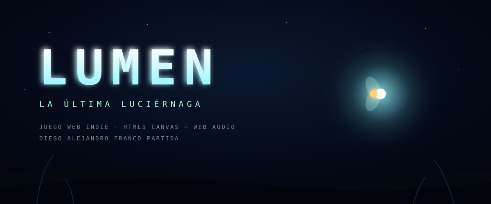
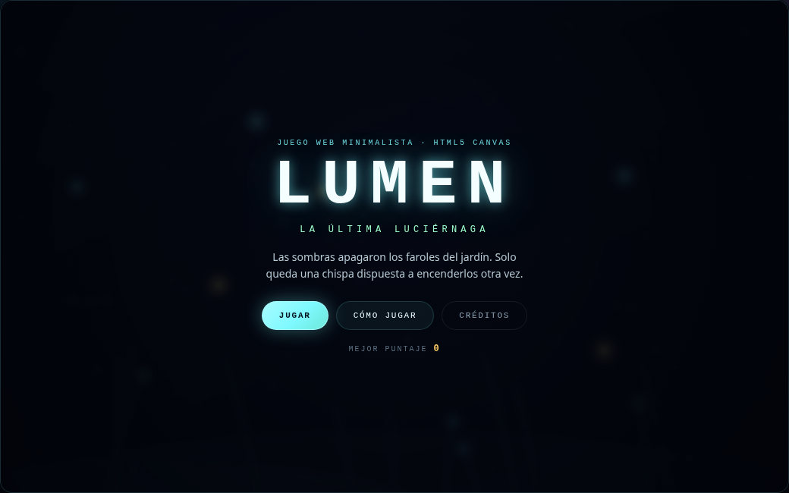
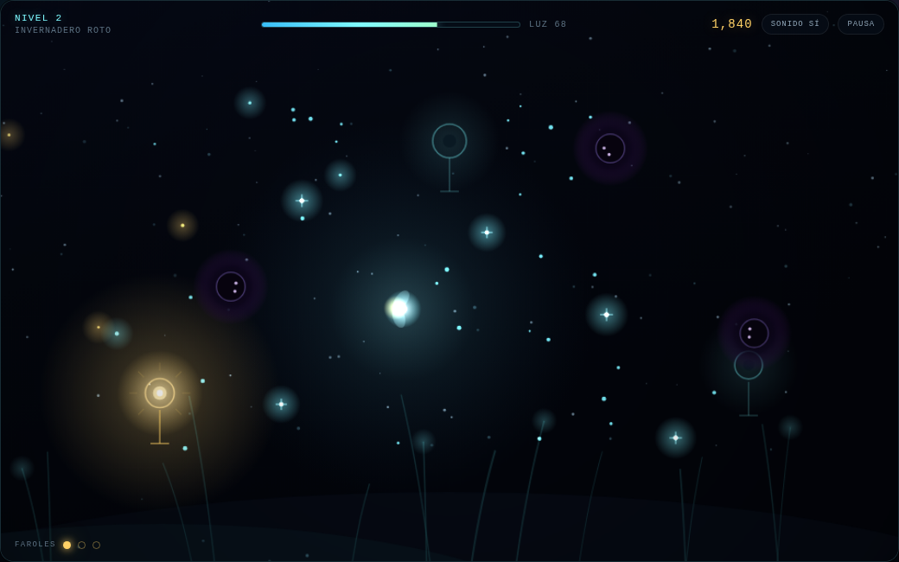
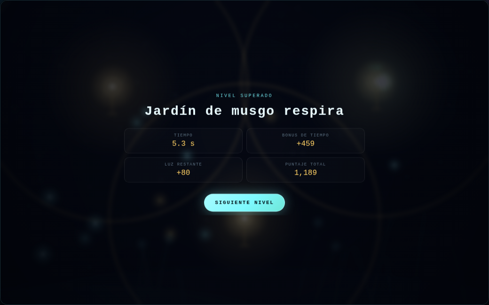

<p align="center">
  
</p>

<h1 align="center">LUMEN</h1>
<p align="center"><strong>La última luciérnaga</strong> · un arcade web minimalista hecho con JavaScript puro</p>

<p align="center">
  
  
  
  
  
</p>

<p align="center">
  <a href="https://diegouth.github.io/lumen/"></a>
  <a href="https://github.com/diegouth/lumen"></a>
</p>

> **Propuesta.** *LUMEN* es un juego web indie básico y minimalista en el que encarnas a la última luciérnaga de un jardín que se quedó sin luz. Tu energía se consume sola: recolecta chispas para mantenerte viva y enciende los tres faroles de cada nivel antes de que las sombras te alcancen. Cinco noches, quince faroles y una sola regla: **no dejes que tu luz se apague**.
>
> Está desarrollado con **JavaScript puro, Canvas 2D y Web Audio API**, sin frameworks, sin librerías y sin archivos externos de imagen o sonido. Todo el arte se dibuja en tiempo real y toda la música y los efectos se sintetizan en el navegador. Se juega en línea, sin instalar nada.

---

## Índice

- [La propuesta](#la-propuesta)
- [Capturas](#capturas)
- [Cómo jugar](#cómo-jugar)
- [Reglas y cálculo del puntaje](#reglas-y-cálculo-del-puntaje)
- [Controles](#controles)
- [Ficha técnica](#ficha-técnica)
- [Arquitectura y estructura](#arquitectura-y-estructura)
- [Ejecutar en local](#ejecutar-en-local)
- [Publicar en GitHub Pages](#publicar-en-github-pages)
- [Documentación del proyecto](#documentación-del-proyecto)
- [Cumplimiento de la actividad](#cumplimiento-de-la-actividad)
- [Plan de trabajo](#plan-de-trabajo)
- [Roadmap](#roadmap)
- [Créditos y licencia](#créditos-y-licencia)

---

## La propuesta

### Concepto

Un arcade de recolección con estética de noche bioluminiscente. La pantalla es casi negra; lo único que ilumina el jardín es tu propia luciérnaga. Cada chispa que recoges alimenta tu luz, y cada farol que enciendes devuelve un pedazo de jardín al mundo. Las sombras no se combaten con armas: se esquivan con movimiento y se disipan con un **destello** que cuesta energía.

La idea nace de una restricción técnica deliberada: **hacer mucho con muy poco**. Un lienzo de 960 × 600, formas geométricas, dos colores principales y sonido generado por código.

### Objetivo del proyecto

Demostrar que un videojuego web completo —con menú, niveles, audio, puntaje, guardado de récord y diseño de juego documentado— puede construirse con tecnologías abiertas de la web, sin motor gráfico ni assets descargados, y publicarse gratuitamente en GitHub Pages.

### Público objetivo

Jugadores ocasionales de 12 años en adelante, estudiantes de programación y cualquier persona que quiera una partida corta de 3 a 6 minutos. El juego no requiere experiencia previa: se aprende en la primera chispa.

### Alcance

| Incluido en la versión 1.0.0 | Fuera de alcance (roadmap) |
| --- | --- |
| 5 niveles con dificultad progresiva | Multijugador |
| 3 faroles por nivel (15 en total) | Editor de niveles |
| Sistema de combo, récord local y bonus | Cuentas y ranking en línea |
| Música generativa y 10 efectos de sonido | Voces y doblaje |
| Controles de teclado, ratón y táctiles | Tienda de cosméticos |
| Diseño accesible: sin dependencias, sin descargas | Versión nativa móvil |

### Elementos diferenciadores

1. **Cero assets.** Ni una imagen ni un audio en el repositorio: el juego pesa menos de 150 KB y carga al instante.
2. **La luz es el recurso.** Vida, puntaje y visibilidad son la misma variable, lo que obliga a tomar decisiones constantes.
3. **Audio generativo.** La música cambia de tonalidad en cada nivel y se programa en tiempo real con osciladores.
4. **Código legible y liberado.** Un solo archivo de lógica comentado, sin transpiladores ni build step.

---

## Capturas

| Menú principal | Juego (nivel 2) |
| --- | --- |
|  |  |

| Nivel superado |
| --- |
|  |

---

## Cómo jugar

1. Abre **[diegouth.github.io/lumen](https://diegouth.github.io/lumen/)** (o ejecuta el proyecto en local, ver más abajo).
2. Pulsa **Jugar**.
3. Muévete con **WASD** o las **flechas**. En móvil, arrastra el dedo.
4. Recoge **chispas** para recuperar luz. Tu luz baja sola todo el tiempo.
5. Acércate a un **farol** con al menos **30 de luz** para encenderlo.
6. Enciende los **3 faroles** del nivel para avanzar.
7. Si tu luz llega a **0**, la partida termina.

> **Truco:** el **destello** (Espacio) cuesta 12 de luz, te da invulnerabilidad breve y disipa las sombras que atraviesa. Úsalo para escapar o para limpiar el camino a un farol.

---

## Reglas y cálculo del puntaje

### Economía de la luz

| Evento | Efecto |
| --- | --- |
| Drenaje natural | −5.0 a −7.0 de luz por segundo (sube con el nivel) |
| Recoger una chispa | +15 de luz |
| Encender un farol | −30 de luz (se requiere tener al menos 30) |
| Golpe de sombra | −22 de luz y empuje |
| Destello | −12 de luz |
| Inicio de nivel | 100 de luz |

### Puntos

| Evento | Fórmula | Ejemplo (nivel 2, combo ×3) |
| --- | --- | --- |
| Chispa | `10 × combo × nivel` | 60 pts |
| Farol encendido | `200 × nivel` | 400 pts |
| Sombra disipada con destello | `25 × nivel` | 50 pts |
| Sombra barrida por la onda del farol | `15 × nivel` | 30 pts |
| Bonus de tiempo | `máx(0, 120 − segundos) × 4` | 42.6 s → +310 |
| Bonus de luz restante | `luz × 2` | 68 → +136 |

- El **combo** sube +1 con cada chispa recogida dentro de una ventana de **2.2 segundos** y llega hasta **×9**. Se reinicia al recibir daño o al dejar pasar la ventana.
- El **récord** se guarda en `localStorage` con la clave `lumen.best` y se muestra en el menú.
- La puntuación se redondea al entero más cercano y se muestra con separador de miles.

### Niveles

| # | Nombre | Sombras | Drenaje | Faroles |
| --- | --- | --- | --- | --- |
| 1 | Jardín de musgo | 2 | 5.0/s | 3 |
| 2 | Invernadero roto | 3 | 5.5/s | 3 |
| 3 | Estanque de luna | 4 | 6.0/s | 3 |
| 4 | Bosque de helechos | 5 | 6.5/s | 3 |
| 5 | Mirador del faro | 6 | 7.0/s | 3 |

Las posiciones de los faroles de cada nivel están fijadas en el código y coinciden con el [mapa del nivel 1](assets/mapa-nivel-1.svg) incluido en el GDD.

---

## Controles

| Acción | Teclado | Ratón / táctil |
| --- | --- | --- |
| Mover | `W` `A` `S` `D` o flechas | Arrastrar sobre el lienzo |
| Destello | `Espacio` | Botón **DESTELLO** (móvil) |
| Pausa | `P` o `Esc` | Botón **PAUSA** |
| Sonido | `M` | Botón **SONIDO SÍ / NO** |
| Empezar / continuar | `Espacio` o `Enter` | Botones del menú |

El botón de destello solo se muestra en dispositivos con pantalla táctil. El juego pausa automáticamente si cambias de pestaña.

---

## Ficha técnica

| Apartado | Detalle |
| --- | --- |
| Nombre | LUMEN — La última luciérnaga |
| Versión | 1.0.0 |
| Género | Arcade / recolección / esquiva |
| Plataforma | Navegador web moderno (Chrome, Firefox, Edge, Safari) |
| Motor | Propio, sobre **Canvas 2D** |
| Lenguaje | JavaScript ES2017+ (vanilla, sin build) |
| Audio | **Web Audio API**, síntesis procedural |
| Persistencia | `localStorage` (récord y preferencia de sonido) |
| Dependencias | **0** |
| Licencia | MIT |
| Repositorio | <https://github.com/diegouth/lumen> |
| Jugar en línea | <https://diegouth.github.io/lumen/> |
| Autor | Diego Alejandro Franco Partida |

### Requisitos para jugar

- Navegador actualizado con soporte de Canvas 2D y Web Audio.
- Resolución mínima recomendada: 360 × 640 (vertical) o 800 × 600 (horizontal).
- No requiere conexión después de cargar la página (el juego es 100 % estático).

Los requerimientos completos de hardware y software para el **desarrollo** del juego y de animación están en [`docs/REQUERIMIENTOS.md`](docs/REQUERIMIENTOS.md).

---

## Arquitectura y estructura

```text
lumen/
├── index.html                  # Estructura, HUD y paneles de interfaz
├── css/
│   └── style.css               # Tema visual, overlays y responsive
├── js/
│   ├── config.js               # Datos del autor, repo y enlaces
│   ├── audio.js                # Web Audio: música generativa + SFX
│   └── game.js                 # Bucle, entidades, niveles, puntaje y render
├── assets/
│   ├── splash.svg              # Portada / logo
│   ├── menu.png                # Captura del menú
│   ├── screenshot.png          # Captura de juego
│   ├── nivel-superado.png      # Captura de fin de nivel
│   ├── storyboard.svg          # Storyboard de 6 viñetas
│   ├── mapa-nivel-1.svg        # Mapa del primer nivel
│   ├── avatar.svg              # Retrato para el GDD
│   └── favicon.svg
├── docs/
│   ├── GDD.md                  # Documento de diseño de juego
│   ├── STORYBOARD.md           # Storyboard y notas de flujo
│   ├── GUION.md                # Guión narrativo y textos del juego
│   ├── REQUERIMIENTOS.md       # Hardware y software (juego y animación)
│   ├── PLAN-DE-TRABAJO.md      # Plan técnico, Git y cronograma
│   └── VIDEO.md                # Guión del video explicativo del código
├── .github/workflows/pages.yml # Despliegue automático en GitHub Pages
├── .nojekyll                   # Evita el procesado de Jekyll en Pages
├── LICENSE                     # MIT
└── README.md                   # Este documento
```

### Cómo está programado

- **`game.js`** contiene el bucle principal con `requestAnimationFrame`, un `dt` limitado a 50 ms para evitar saltos y un render por capas (fondo → aura → entidades → partículas → viñeta).
- **Entidades** — `sparks`, `shadows` y `lanterns` son arreglos de objetos simples. Las colisiones son círculo–círculo, sin motor físico.
- **Estados** — `menu`, `help`, `credits`, `intro`, `playing`, `paused`, `levelClear`, `gameover` y `victory`. Cada estado decide qué actualiza, qué dibuja y qué panel muestra.
- **Dibujo** — todo se genera con gradientes radiales, `globalCompositeOperation = 'lighter'` y partículas; no se carga ninguna imagen en el canvas.
- **Audio** — `audio.js` crea un `AudioContext` en el primer gesto del usuario. La música usa un planificador con *lookahead* de 0.7 s y notas de una escala pentatónica; los SFX son osciladores y ruido filtrado con envolventes cortas.
- **Accesibilidad y rendimiento** — se respeta `prefers-reduced-motion`, se pausa al perder el foco, el HUD expone `role="progressbar"`, y el juego funciona con `file://` (sin módulos ES) y con cualquier servidor estático.

---

## Ejecutar en local

No hay instalación ni build. Basta con servir la carpeta:

```bash
# Opción 1: Python
python3 -m http.server 8765
# Abre http://localhost:8765

# Opción 2: Node
npx serve .
```

También puedes abrir `index.html` directamente, aunque algunos navegadores restringen el audio en `file://`; si no escuchas nada, usa un servidor local.

### Parámetros de desarrollo

| Parámetro | Uso |
| --- | --- |
| `?demo=1` | Carga una escena de demostración congelada para tomar capturas. |
| `?capture=1` | Desactiva transiciones y animaciones (documentación). |
| `?test=1` | Modo QA: desactiva el daño y el drenaje para probar el flujo de niveles. **No usar para jugar.** |

---

## Publicar en GitHub Pages

El repositorio ya incluye un workflow (`.github/workflows/pages.yml`) que publica el sitio en cada `push` a `main`.

Pasos para dejarlo en línea desde cero:

```bash
# 1. Crear el repositorio en GitHub con el nombre "lumen"
git init
git add .
git commit -m "feat: LUMEN v1.0.0, juego web minimalista"
git branch -M main
git remote add origin https://github.com/diegouth/lumen.git
git push -u origin main
```

2. En GitHub ve a **Settings → Pages** y elige **Source: GitHub Actions**.
3. Espera a que termine el workflow *Deploy static content to Pages*.
4. Abre **<https://diegouth.github.io/lumen/>**.

> Si tu usuario u repositorio tienen otro nombre, actualiza `js/config.js`, este README y `docs/` para que los enlaces coincidan. También puedes publicar sin Actions: **Settings → Pages → Deploy from a branch → main / (root)**.

---

## Documentación del proyecto

> **Portafolio navegable:** <https://diegouth.github.io/lumen/docs/> — todos los documentos en HTML, con su versión en **PDF** descargable.

| Documento | Contenido | En línea | PDF |
| --- | --- | --- | --- |
| [GDD](docs/GDD.md) | Concepto, historia, mecánicas, personajes, niveles, armas, vestimenta, props, música, SFX, score y créditos. | [HTML](https://diegouth.github.io/lumen/docs/GDD.html) | [PDF](docs/pdf/GDD.pdf) |
| [Storyboard](docs/STORYBOARD.md) | Seis viñetas del flujo de juego, con bocetos y notas. | [HTML](https://diegouth.github.io/lumen/docs/STORYBOARD.html) | [PDF](docs/pdf/Storyboard.pdf) |
| [Guión](docs/GUION.md) | Textos de introducción, diálogos del farolero, finales y tono narrativo. | [HTML](https://diegouth.github.io/lumen/docs/GUION.html) | [PDF](docs/pdf/Guion.pdf) |
| [Requerimientos](docs/REQUERIMIENTOS.md) | Hardware y herramientas de software para desarrollo de videojuegos y animación. | [HTML](https://diegouth.github.io/lumen/docs/REQUERIMIENTOS.html) | [PDF](docs/pdf/Requerimientos.pdf) |
| [Plan de trabajo](docs/PLAN-DE-TRABAJO.md) | Cronograma, flujo Git, ramas, convenciones de commit y checklist de pruebas. | [HTML](https://diegouth.github.io/lumen/docs/PLAN-DE-TRABAJO.html) | [PDF](docs/pdf/Plan-de-trabajo.pdf) |
| [Guión del video](docs/VIDEO.md) | Guion de 90 segundos para el video explicativo del código. | [HTML](https://diegouth.github.io/lumen/docs/VIDEO.html) | [PDF](docs/pdf/Guion-del-video.pdf) |

---

## Cumplimiento de la actividad

| Requisito de la actividad | Dónde se entrega |
| --- | --- |
| Repositorio creado y README elaborado | Este README + repo `diegouth/lumen` |
| Disponible en GitHub Pages para jugar en línea | <https://diegouth.github.io/lumen/> + workflow |
| Propuesta personalizada en el README | Sección [La propuesta](#la-propuesta) |
| Código completo desarrollado y liberado | `js/`, `css/`, `index.html` + [LICENSE](LICENSE) MIT |
| Audio sencillo y efectos | `js/audio.js` + sección de audio del [GDD](docs/GDD.md) |
| Video corto explicativo del código | Guion en [`docs/VIDEO.md`](docs/VIDEO.md) (pendiente de grabación) |
| Documento técnico de hardware y software | [`docs/REQUERIMIENTOS.md`](docs/REQUERIMIENTOS.md) · [HTML](https://diegouth.github.io/lumen/docs/REQUERIMIENTOS.html) · [PDF](docs/pdf/Requerimientos.pdf) |
| GDD con portada, integrantes, nombre e imagen | [`docs/GDD.md`](docs/GDD.md) + `assets/splash.svg` |
| Género, público, historia, mecánicas, personajes, niveles, armas, vestimenta, props | Secciones 3–10 del [GDD](docs/GDD.md) |
| Mapa de al menos un nivel | [`assets/mapa-nivel-1.svg`](assets/mapa-nivel-1.svg) + sección 6.1 del GDD |
| Storyboard y guión | [`docs/STORYBOARD.md`](docs/STORYBOARD.md) y [`docs/GUION.md`](docs/GUION.md) |
| Música por niveles y efectos de audio | Secciones 12–13 del [GDD](docs/GDD.md) |
| Score sobre eventos | [Reglas y puntaje](#reglas-y-cálculo-del-puntaje) y sección 11 del GDD |
| Plan de trabajo y flujo Git | [`docs/PLAN-DE-TRABAJO.md`](docs/PLAN-DE-TRABAJO.md) |
| Créditos | [Créditos](#créditos-y-licencia) + pantalla de créditos del juego |
| Portafolio de evidencias navegable | <https://diegouth.github.io/lumen/docs/> |

---

## Plan de trabajo

Resumen del cronograma (detalle completo en [`docs/PLAN-DE-TRABAJO.md`](docs/PLAN-DE-TRABAJO.md)):

| Fecha | Entrega |
| --- | --- |
| 4 nov | Concepto, referencias y definición del *core loop*. |
| 5–6 nov | Prototipo de movimiento, colisiones y luz. |
| 7 nov | Niveles, faroles, sombras y puntaje. |
| 8 nov | Audio procedural, HUD y paneles de interfaz. |
| 9 nov | Responsive, accesibilidad, pruebas y balance. |
| 10 nov | GDD, storyboard, guión, requerimientos y README. |
| 11 nov | Grabación del video, revisión final y despliegue en Pages. |
| 12 nov | Entrega (23:59). |

Flujo Git: `main` estable, ramas `feat/*` y `docs/*`, commits convencionales (`feat:`, `fix:`, `docs:`, `style:`, `test:`), etiqueta `v1.0.0` y despliegue automático.

---

## Roadmap

- [ ] Modo contrarreloj y modo infinito.
- [ ] Faroles que se apagan con el tiempo (gestión de rutas).
- [ ] Paletas desbloqueables por récord.
- [ ] Tabla de posiciones local por nivel.
- [ ] Más efectos de partículas con `OffscreenCanvas`.
- [ ] Soporte de gamepad.
- [ ] Traducción al inglés (i18n ligera).

---

## Créditos y licencia

**Diseño, programación, arte vectorial y audio:** Diego Alejandro Franco Partida.

- Inspiración: los arcades minimalistas, la luz de las luciérnagas y la idea de que un jardín puede caber en una pantalla.
- Tecnologías: HTML5, CSS3, JavaScript, Canvas 2D y Web Audio API.
- Tipografías: fuentes del sistema (sin licencias externas).
- Música y efectos: síntesis procedural original; no se usan samples de terceros.
- Agradecimientos: a las comunidades de MDN y Web Audio por la documentación abierta.

Código liberado bajo la licencia **MIT**; consulta [LICENSE](LICENSE). Puedes usarlo, modificarlo y redistribuirlo conservando el aviso de autoría.

<p align="center">
  <sub>LUMEN v1.0.0 · hecho de noche, con JavaScript y una luciérnaga.</sub>
</p>
