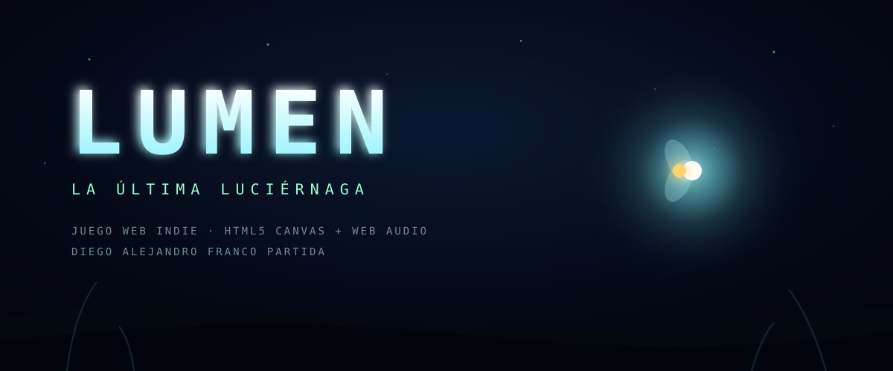
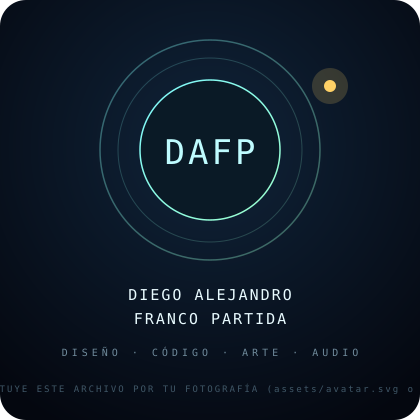
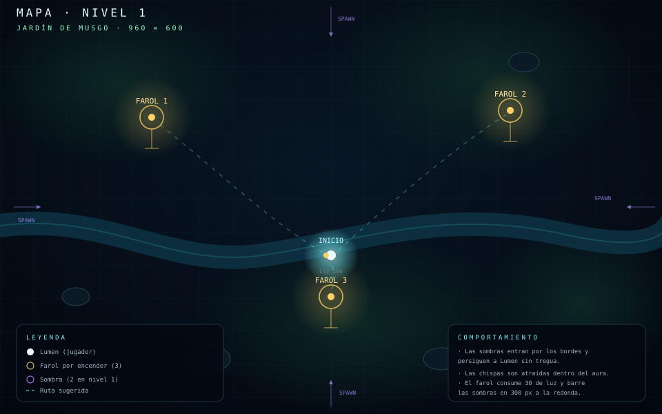
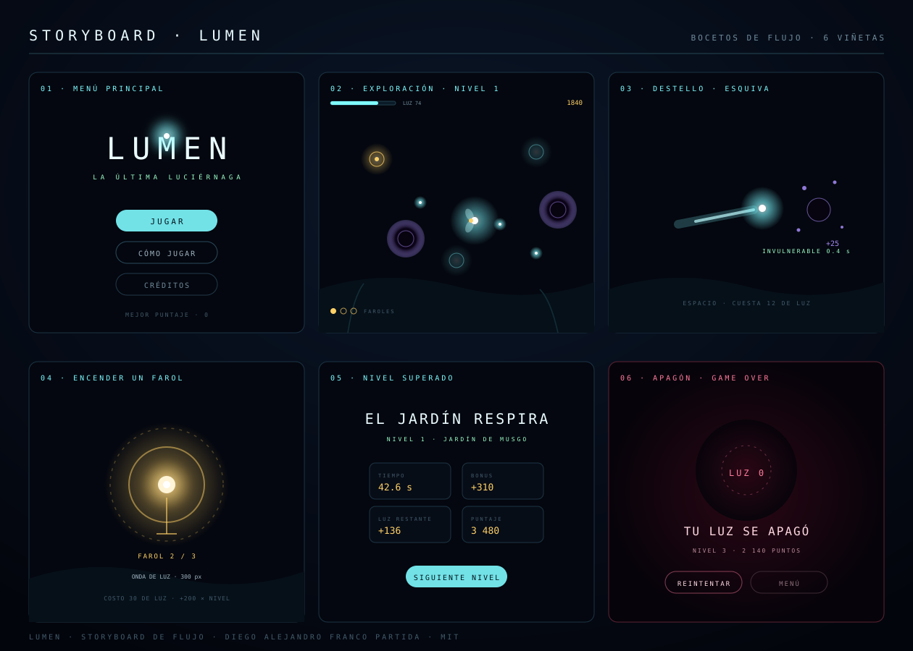

# LUMEN — Documento de Diseño de Juego (GDD)

> Versión Lean · v1.0.0 · Noviembre de 2026

---

## 1. Portada

<p align="center">
  
</p>

### Ficha del proyecto

| Campo | Detalle |
| --- | --- |
| **Nombre del juego** | LUMEN — La última luciérnaga |
| **Género** | Arcade de recolección y esquiva |
| **Plataforma** | Navegador web (HTML5 Canvas) |
| **Versión** | 1.0.0 |
| **Autor** | Diego Alejandro Franco Partida |
| **Materia** | Desarrollo de Videojuegos |
| **Fecha** | Noviembre de 2026 |
| **Repositorio** | <https://github.com/diegouth/lumen> |
| **Jugar en línea** | <https://diegouth.github.io/lumen/> |
| **Licencia** | MIT |

### Integrante

<table>
  <tr>
    <td width="140" align="center">
      
    </td>
    <td>
      <strong>Diego Alejandro Franco Partida</strong><br>
      Diseño de juego, programación, arte vectorial, audio y documentación.<br>
      <em>Proyecto individual.</em><br><br>
      <sub>Nota: sustituye <code>assets/avatar.svg</code> por tu fotografía para la entrega final.</sub>
    </td>
  </tr>
</table>

---

## 2. Concepto

**LUMEN** es un arcade minimalista en el que controlas a la última luciérnaga de un jardín que perdió su luz. La energía de Lumen disminuye constantemente; recolectar chispas la alimenta y encender faroles devuelve la luz al entorno. Las sombras, atraídas por el brillo, la persiguen sin descanso.

**Pitch en una frase:** *recoge luz, enciende faroles y sobrevive a cinco noches antes de que tu propia chispa se apague.*

### Pilares de diseño

1. **La luz es vida, puntaje y visibilidad a la vez.** Una sola variable obliga a decidir entre explorar, encender o escapar.
2. **Movimiento expresivo.** El destello convierte la defensa en una decisión de riesgo: cuesta luz, pero abre camino.
3. **Ritmo corto y legible.** Cada nivel dura entre 40 y 90 segundos; todo cabe en una pantalla y se entiende en la primera partida.
4. **Estética de noche.** Fondo casi negro, brillos bioluminiscentes y una paleta de tres acentos.

---

## 3. Género y público objetivo

| Aspecto | Definición |
| --- | --- |
| **Género principal** | Arcade / *collect-a-thon* |
| **Subgéneros** | Esquiva, *score attack*, *dodge ’em up* |
| **Perspectiva** | Vista cenital 2D |
| **Modo** | Un jugador, partidas de 3 a 6 minutos |
| **Curva de dificultad** | Progresiva por nivel (más sombras, más drenaje, más velocidad) |
| **Público primario** | Jugadores casuales de 12 a 35 años |
| **Público secundario** | Estudiantes de programación y docentes que buscan un ejemplo completo y libre |
| **Experiencia previa requerida** | Ninguna |
| **Clasificación sugerida** | ATP / E (violencia fantástica mínima, sin sangre) |

### Motivaciones del jugador

- **Competencia consigo mismo:** superar el récord guardado.
- **Dominio:** aprender a leer el movimiento de las sombras y encadenar combos.
- **Exploración:** descubrir los cinco escenarios y su música.
- **Relajación activa:** una experiencia corta, sin castigos severos ni curvas de aprendizaje largas.

---

## 4. Historia y ambientación

### Premisa

Hace mucho tiempo, el jardín de *Valdeflor* se iluminaba cada noche con cientos de luciérnagas. Una noche, una niebla sin nombre —**el Olvido**— apagó los faroles y se llevó la luz. Las luciérnagas se apagaron una a una. Solo quedó **Lumen**, la más pequeña, despierta por casualidad.

### Sinopsis

Lumen despierta en un jardín que ya no reconoce. Los faroles que antes marcaban los caminos están fríos, y unas sombras con ojos de violeta recorren la oscuridad. Una vocecita —el último farolero— le explica que la luz no se perdió: está dispersa en chispas que flotan entre las plantas. Si Lumen enciende los quince faroles del jardín, la noche volverá a ser suya.

Cada nivel es una zona del jardín, y cada farol encendido devuelve un recuerdo: el musgo, el invernadero, el estanque, los helechos y, al final, el mirador desde donde se ve el mar.

### Tono

Íntimo, nocturno y esperanzador. Sin diálogos largos: la historia se cuenta en tres líneas de introducción por nivel y en la voz del farolero. La melancolía se resuelve en luz.

### Temas

- La memoria como fuente de luz.
- La comunidad (muchas luciérnagas) frente al individualismo (una sola).
- El miedo a la oscuridad y la valentía de volver a encender.

---

## 5. Personajes

### Lumen — protagonista

| Atributo | Descripción |
| --- | --- |
| **Especie** | Luciérnaga joven |
| **Tamaño** | 11 px de radio en pantalla (un punto de luz) |
| **Color** | Núcleo blanco cian; abdomen ámbar |
| **Personalidad** | Curiosa, terca, incapaz de dejar un farol apagado |
| **Habilidad** | Destello: un latido de luz que la vuelve intangible y disipa sombras |
| **Debilidad** | Su luz se consume con el tiempo |
| **Arco** | De sobrevivir sola a devolver la luz a todo el jardín |

**Diseño visual:** un punto blanco con un halo cian, dos alas translúcidas que baten a 24 Hz y un abdomen ámbar que parpadea al ritmo del combo. Al recibir daño parpadea; al hacer destello deja una estela de luz.

### Las Sombras — antagonista

| Atributo | Descripción |
| --- | --- |
| **Origen** | El Olvido: luz que se apagó y olvidó su nombre |
| **Apariencia** | Círculos negros con borde violeta y dos ojos claros |
| **Comportamiento** | Persiguen a Lumen con oscilación; se separan entre sí; se vuelven más rápidas cuando la luz de Lumen baja |
| **Debilidad** | El destello y la onda de un farol |
| **Función** | Presionar sin castigar de forma injusta; son lentas, pero nunca se detienen |

### El Farolero — voz guía

Personaje no visible. Su voz aparece en los textos de introducción y en el final. Es la memoria del jardín y quien le explica a Lumen para qué sirve cada farol.

> «La luz no se gasta, pequeña. Solo cambia de manos.»

### Las luciérnagas antiguas — trasfondo

No aparecen en pantalla. Son las luces que se apagaron; su recuerdo se recupera al encender cada farol. En el final, el jardín vuelve a llenarse de puntos de luz.

---

## 6. Niveles

### Estructura general

- **5 niveles**, cada uno con **3 faroles** (15 faroles en total).
- Los faroles tienen posiciones fijas por nivel (diseño de mapa), las chispas aparecen en posiciones aleatorias y las sombras entran por los bordes.
- El nivel termina cuando los tres faroles están encendidos; no hay temporizador, pero el drenaje de luz presiona constantemente.
- Las posiciones de los faroles del nivel 1 coinciden con el mapa de la sección 6.1.

| Nivel | Escenario | Sombras | Drenaje | Velocidad base | Chispas | Faroles (x, y) |
| --- | --- | --- | --- | --- | --- | --- |
| 1 | Jardín de musgo | 2 | 5.0/s | 62 px/s | 7 | (220, 170) · (740, 160) · (480, 430) |
| 2 | Invernadero roto | 3 | 5.5/s | 72 px/s | 7 | (170, 420) · (480, 150) · (800, 390) |
| 3 | Estanque de luna | 4 | 6.0/s | 82 px/s | 8 | (250, 140) · (710, 250) · (470, 470) |
| 4 | Bosque de helechos | 5 | 6.5/s | 92 px/s | 8 | (140, 300) · (520, 120) · (810, 470) |
| 5 | Mirador del faro | 6 | 7.0/s | 102 px/s | 9 | (180, 160) · (780, 170) · (490, 330) |

> La velocidad efectiva de las sombras suma **+4 px/s por nivel** y hasta un **28 % adicional** cuando la luz de Lumen está baja, como mecanismo de tensión.

### 6.1 Mapa del nivel 1 — Jardín de musgo

<p align="center">
  
</p>

**Comportamiento general del mapa**

- Lumen aparece en el centro-sur (480, 370) con 100 de luz.
- El farol 3 está a pocos pasos (480, 430), pensado como tutorial: el jugador aprende a encender sin recorrer todo el mapa.
- Los faroles 1 y 2 obligan a cruzar el jardín en diagonal, pasando por el arroyo y las zonas de musgo.
- Las sombras entran por los cuatro bordes; no hay zonas seguras permanentes, solo rutas.
- Las chispas aparecen en cualquier punto con margen de 60 px y a más de 130 px del jugador, para que nunca haya una chispa «gratis».
- El aura de Lumen (90 a 166 px según la luz) atrae las chispas cercanas, lo que convierte la recolección en un pequeño imán.

### 6.2 Progresión narrativa

| Nivel | Introducción | Lectura |
| --- | --- | --- |
| 1 | «Las luciérnagas antiguas dormían entre el musgo. Despiértalas.» | Tutorial y melancolía. |
| 2 | «El cristal roto corta la noche. Las sombras ya saben dónde estás.» | El peligro se vuelve activo. |
| 3 | «El estanque refleja un cielo que ya no existe. No te detengas.» | Reflexión y velocidad. |
| 4 | «Los helechos susurran nombres antiguos. Corre antes de que te alcancen.» | Persecución y dominio. |
| 5 | «Desde el mirador se ve el último faro. Enciéndelo y devuelve la noche a las estrellas.» | Clímax y resolución. |

---

## 7. Armas y habilidades

LUMEN no usa armas convencionales: la protagonista es una luciérnaga, y su única herramienta es la luz. Las «armas» del diseño son **habilidades con costo de energía**, coherentes con la fantasía del personaje.

### 7.1 Destello (habilidad activa)

| Parámetro | Valor |
| --- | --- |
| **Entrada** | `Espacio` (teclado) / botón **DESTELLO** (táctil) |
| **Costo** | 12 de luz |
| **Duración** | 0.16 s de impulso a 760 px/s |
| **Enfriamiento** | 1.05 s |
| **Invulnerabilidad** | 0.42 s |
| **Efecto** | Disipa las sombras que atraviesa (+25 × nivel puntos) |

**Uso táctico:** escapar de un cerco, cruzar entre dos sombras, limpiar el camino a un farol o encadenar puntos. No es un ataque a distancia: obliga a arriesgar el cuerpo.

### 7.2 Onda del farol (habilidad ambiental)

| Parámetro | Valor |
| --- | --- |
| **Activación** | Tocar un farol con al menos 30 de luz |
| **Costo** | 30 de luz |
| **Radio** | 300 px |
| **Efecto** | Enciende el farol, barre las sombras dentro del radio (+15 × nivel) y genera una onda visual de 0.75 s |
| **Puntos** | +200 × nivel |

Es la recompensa y la principal fuente de alivio: convierte la energía acumulada en espacio seguro.

### 7.3 Sin armas de fuego

No hay proyectiles, munición ni combate cuerpo a cuerpo. La decisión de diseño busca que el jugador **lea el espacio y administre un recurso** en lugar de apuntar. La tensión viene de la escasez de luz, no de la puntería.

---

## 8. Vestimenta y estética de Lumen

Lumen no lleva ropa: su «vestimenta» es su propia biología luminosa. El diseño funciona como un traje de luz que comunica el estado del jugador.

| Elemento | Descripción | Función de juego |
| --- | --- | --- |
| **Núcleo** | Punto blanco de 4.6 px con halo cian | Legibilidad y punto de mira |
| **Abdomen** | Esfera ámbar de 3.2 px | Identidad de luciérnaga; guiño al farol |
| **Alas** | Dos elipses translúcidas que baten | Sensación de vuelo y fragilidad |
| **Aura** | Gradiente cian de 90–166 px | Radio de recolección y de visibilidad |
| **Estela** | Partículas cian al moverse | Velocidad y dirección |
| **Parpadeo** | Alternancia de alfa al recibir daño | Comunicar invulnerabilidad |
| **Combo** | El abdomen brilla más con combos altos | Feedback de puntaje |

**Paleta del personaje:** blanco `#ffffff`, cian `#7ef9ff`, menta `#9dffcb`, ámbar `#ffd166`.

**Nota de producción:** no hay sistema de cosméticos en la v1.0.0. La idea a futuro es desbloquear paletas (por ejemplo, «Lumen de otoño» en ámbar y rosa) al superar récords, sin afectar la jugabilidad.

---

## 9. Objetos especiales, props y background

### Objetos interactivos

| Objeto | Apariencia | Función |
| --- | --- | --- |
| **Chispa** | Estrella de cuatro puntas con halo cian | +15 de luz, +puntos, alimenta el combo |
| **Farol** | Aro con núcleo ámbar sobre un poste | Objetivo del nivel; cuesta 30 de luz; onda de luz |
| **Sombra** | Círculo negro con borde violeta y ojos | Amenaza; quita 22 de luz; se disipa con destello/onda |
| **Onda de luz** | Anillo ámbar expansivo | Feedback del farol; limpia sombras |

### Props decorativos

| Prop | Descripción | Capa |
| --- | --- | --- |
| **Musgo** | Manchas verdes oscuras en el suelo | Fondo |
| **Arroyo / estanque** | Trazo azul verdoso con brillo tenue | Fondo (nivel 3) |
| **Rocas** | Elipses oscuras con borde azulado | Fondo |
| **Tallos y helechos** | Líneas curvas que nacen del borde inferior | Fondo / primer plano |
| **Estrellas** | 85 puntos con parpadeo independiente | Fondo lejano |
| **Motas de polen** | 40 puntos flotantes con paralaje | Fondo medio |
| **Luciérnagas de fondo** | 6 puntos con movimiento sinusoidal | Fondo lejano |
| **Viñeta** | Gradiente radial que oscurece los bordes | Postproceso |

### Background por nivel

1. **Jardín de musgo:** musgo, tréboles, luciérnagas dormidas.
2. **Invernadero roto:** cristales, macetas, reflejos fríos.
3. **Estanque de luna:** agua, juncos, reflejo de una luna ausente.
4. **Bosque de helechos:** tallos altos, sombras alargadas.
5. **Mirador del faro:** cielo abierto, horizonte y el último farol.

> En la v1.0.0 el fondo es procedural y comparte la misma base (estrellas, motas, tallos y silueta), con variaciones de color y distribución por nivel. El mapa y los props descritos aquí son la guía para una futura capa de arte dedicada.

---

## 10. Controles, cámara e interfaz

### Controles

| Acción | Teclado | Ratón | Táctil |
| --- | --- | --- | --- |
| Mover | `WASD` / flechas | Arrastrar | Arrastrar el dedo |
| Destello | `Espacio` | — | Botón **DESTELLO** |
| Pausa | `P` / `Esc` | Botón **PAUSA** | Botón **PAUSA** |
| Sonido | `M` | Botón **SONIDO** | Botón **SONIDO** |
| Confirmar | `Espacio` / `Enter` | Botones | Botones |

### Cámara

Fija, cenital, sin scroll. Todo el nivel cabe en 960 × 600 unidades lógicas. La sensación de espacio se logra con paralaje de fondo y viñeta, no con movimiento de cámara.

### HUD

- **Arriba a la izquierda:** nivel y nombre del escenario.
- **Arriba al centro:** barra de luz (100 puntos) con etiqueta numérica; se vuelve roja y pulsa por debajo de 25.
- **Arriba a la derecha:** puntaje, botón de sonido y pausa.
- **Abajo a la izquierda:** tres puntos de farol (encendido / apagado).
- **Abajo a la derecha:** combo activo.
- **Centro:** textos flotantes de puntaje y avisos («Necesitas 30 de luz», «FAROL ENCENDIDO»).

### Accesibilidad

- Controles completos por teclado y por puntero.
- `prefers-reduced-motion` desactiva animaciones y transiciones.
- Pausa automática al cambiar de pestaña o perder el foco.
- Barra de luz con `role="progressbar"` y valor accesible.
- Contraste alto: texto claro sobre fondo oscuro y acentos saturados.
- Sin parpadeos rápidos de pantalla completa (el *flash* se limita al 70 % de alfa).

---

## 11. Bucle de juego y score

### Bucle principal

```
Explorar → recoger chispas → mantener la luz → encender faroles → nivel superado
     ↑                                                              ↓
     └──────────────────── nuevo nivel, más sombras ────────────────┘
```

### Condiciones

- **Victoria de nivel:** 3 faroles encendidos.
- **Derrota:** luz a 0 por drenaje o por golpes.
- **Victoria de partida:** superar el nivel 5.
- **Récord:** se guarda en `localStorage` al terminar o perder.

### Tabla de puntaje

| Evento | Fórmula | Notas |
| --- | --- | --- |
| Chispa | `10 × combo × nivel` | El combo se calcula antes de incrementarse |
| Farol | `200 × nivel` | Se suma al encender |
| Sombra por destello | `25 × nivel` | Solo si se atraviesa durante el impulso |
| Sombra por onda de farol | `15 × nivel` | Todas las que estén a menos de 300 px |
| Bonus de tiempo | `máx(0, 120 − s) × 4` | Premia terminar rápido |
| Bonus de luz | `luz restante × 2` | Premia administrar el recurso |

**Combo:** ×1 a ×9; ventana de 2.2 s; se reinicia con daño o al vencer la ventana.

**Ejemplo de cálculo (nivel 2, partida de 52.4 s, 68 de luz, 3 faroles, 22 chispas con combo medio ×3):**

```
chispas:   22 × (10 × 3 × 2)        = 1 320
faroles:   3 × (200 × 2)            = 1 200
tiempo:    máx(0, 120 − 52.4) × 4   =   270
luz:       68 × 2                   =   136
total                               = 2 926
```

### Feedback

Cada evento tiene respuesta en tres canales: partículas, sonido y texto flotante. El daño añade sacudida de pantalla y un *flash* rosa; el farol, un *flash* ámbar, onda expansiva y acorde mayor.

---

## 12. Música

La música es **generativa**: no hay archivos de audio; se programa en tiempo real con `OscillatorNode`, `BiquadFilterNode` y `GainNode`. Cada nivel tiene una nota raíz distinta, de modo que el jugador percibe el cambio de escenario sin necesidad de una melodía fija.

| Nivel | Escenario | Nota raíz | Frecuencia | Carácter |
| --- | --- | --- | --- | --- |
| 1 | Jardín de musgo | La3 | 220.00 Hz | Cálido, introductorio |
| 2 | Invernadero roto | Sol3 | 196.00 Hz | Más grave, inquieto |
| 3 | Estanque de luna | Si3 | 246.94 Hz | Cristalino, suspendido |
| 4 | Bosque de helechos | Fa3 | 174.61 Hz | Oscuro, urgente |
| 5 | Mirador del faro | Do4 | 261.63 Hz | Elevado, esperanzador |

### Capas de la música

1. **Dron:** dos osciladores senoidales (raíz y quinta) a través de un filtro paso bajo con un LFO de 0.06 Hz que «respira».
2. **Pad:** notas de una escala pentatónica mayor, con ataque de 0.9 s y liberación de 3.6 s, programadas cada 2.7–3.4 s con un planificador de 0.7 s de anticipación.
3. **Campanas:** un seno agudo cada cuatro pasos, con caída de 1.8 s.

### Reglas de mezcla

- La música se detiene en el menú y al perder, y se funde en 0.18 s al cambiar de nivel.
- El volumen general es bajo (0.55 de música, 0.9 de SFX) para no tapar los efectos.
- El audio se desbloquea con el primer gesto del usuario, respetando las políticas de reproducción automática de los navegadores.
- El botón de sonido silencia todo el grafo y recuerda la preferencia en `localStorage`.

---

## 13. Efectos de audio

| Efecto | Evento | Síntesis | Duración |
| --- | --- | --- | --- |
| `collect` | Recoger chispa | Seno + triángulo, nota pentatónica según combo, ruido agudo | 0.2 s |
| `dash` | Destello | Ruido filtrado barrido 500→3200 Hz + seno 180→720 Hz | 0.22 s |
| `poof` | Sombra disipada | Triángulo 340→130 Hz + ruido descendente | 0.16 s |
| `hurt` | Golpe de sombra | Sierra 190→52 Hz + ruido 900→120 Hz | 0.38 s |
| `lantern` | Encender farol | Acorde de 5 notas (Do mayor add9) + ruido brillante | 1.5 s |
| `deny` | Acción sin luz | Cuadrada 150→110 Hz, filtro bajo | 0.14 s |
| `levelup` | Nivel superado | Arpegio ascendente de 6 notas | 0.45 s por nota |
| `gameover` | Luz a 0 | Descenso cromático de 5 notas + ruido grave | 0.9 s por nota |
| `victory` | Final | Acorde de 7 notas y colchón de ruido | 2.4 s |
| `click` | Interfaz | Seno 880→660 Hz | 0.07 s |

**Diseño:** los sonidos de recolección suben de tono con el combo; el daño y el apagón usan frecuencias graves y filtros cerrados; los momentos positivos usan senos y acordes abiertos. Todo se genera sin samples para mantener el repositorio ligero y la licencia limpia.

---

## 14. Arte y dirección visual

### Paleta

| Color | Hex | Uso |
| --- | --- | --- |
| Fondo profundo | `#04050c` / `#02040a` | Noche |
| Cian luz | `#7ef9ff` | Lumen, chispas, interfaz |
| Menta | `#9dffcb` | Aciertos, combo, subtítulos |
| Ámbar | `#ffd166` | Faroles, puntaje |
| Violeta | `#a78bfa` | Sombras |
| Rosa | `#ff7b9c` | Daño, advertencia |

### Principios

1. **Legibilidad antes que detalle:** cada entidad es una forma simple con un halo.
2. **Contraste por luminosidad:** el fondo nunca compite con la acción.
3. **Menos es más:** una fuente monoespaciada para HUD y títulos; sin iconos decorativos.
4. **Todo procedural:** gradientes, partículas y trazos; cero texturas descargadas.

### Tipografía

- HUD, títulos y botones: `ui-monospace`, `SFMono-Regular`, `Menlo`, `Consolas`, `monospace`.
- Texto narrativo: fuente del sistema (`Segoe UI`, `system-ui`).
- Sin fuentes externas: carga instantánea y licencias limpias.

---

## 15. Requerimientos técnicos

El detalle de hardware y software para el desarrollo del juego y de animación está en [`REQUERIMIENTOS.md`](REQUERIMIENTOS.md). Resumen:

- **Jugar:** cualquier navegador moderno con Canvas 2D y Web Audio; 2 GB de RAM; sin GPU dedicada.
- **Desarrollar:** equipo con 8 GB de RAM, VS Code, Git, navegador con DevTools y servidor estático local.
- **Animar/ilustrar:** Inkscape o Figma para SVG, Krita o GIMP para mapas de bits, Audacity opcional para referencia sonora.
- **Publicar:** cuenta de GitHub y GitHub Pages (gratuito).

---

## 16. Storyboard y guión

- **Storyboard completo (6 viñetas):** [`STORYBOARD.md`](STORYBOARD.md)
- **Guión narrativo y textos del juego:** [`GUION.md`](GUION.md)

<p align="center">
  
</p>

---

## 17. Plan de trabajo

Cronograma, ramas, convenciones de commit y checklist de pruebas: [`PLAN-DE-TRABAJO.md`](PLAN-DE-TRABAJO.md).

| Hito | Fecha | Estado |
| --- | --- | --- |
| Concepto y propuesta | 4 nov | ✅ |
| Prototipo jugable | 5–6 nov | ✅ |
| Niveles y puntaje | 7 nov | ✅ |
| Audio y UI | 8 nov | ✅ |
| Pruebas y balance | 9 nov | ✅ |
| Documentación | 10 nov | ✅ |
| Video y despliegue | 11 nov | ⏳ |
| Entrega | 12 nov | ⏳ |

---

## 18. Riesgos y limitaciones

| Riesgo | Impacto | Mitigación |
| --- | --- | --- |
| Políticas de autoplay bloquean el audio | Medio | El audio se inicia con el primer gesto y hay botón de silencio |
| Pantallas muy pequeñas en vertical | Medio | Controles táctiles, HUD compacto y paneles desplazables; se recomienda horizontal |
| Rendimiento en equipos antiguos | Bajo | Canvas 2D, menos de 500 partículas, `dt` limitado y sin sombras costosas |
| Pérdida del récord al limpiar el navegador | Bajo | Se informa que el récord es local; no hay cuentas |
| Balance demasiado difícil | Medio | Drenaje configurable por nivel, chispas abundantes, onda de farol y modo QA |
| Assets SVG no renderizados en algún visor | Bajo | Se incluyen capturas PNG de respaldo en el README |

### Limitaciones conocidas

- El récord es local (no hay servidor).
- No hay guardado de partida a mitad de nivel.
- La música es procedural y no tiene una melodía fija; cada partida suena distinta.
- El modo QA (`?test=1`) desactiva daño y drenaje; no debe usarse para jugar.

---

## 19. Créditos

| Rol | Responsable |
| --- | --- |
| Diseño de juego y GDD | Diego Alejandro Franco Partida |
| Programación (Canvas, lógica, audio) | Diego Alejandro Franco Partida |
| Arte vectorial (splash, mapa, storyboard) | Diego Alejandro Franco Partida |
| Música y efectos | Diego Alejandro Franco Partida (síntesis procedural) |
| Documentación y pruebas | Diego Alejandro Franco Partida |
| Motor | HTML5 Canvas 2D + Web Audio API |
| Licencia | MIT |

Agradecimientos a la documentación abierta de MDN y a la comunidad de Web Audio.

<p align="center"><sub>LUMEN · Documento de diseño · v1.0.0</sub></p>
