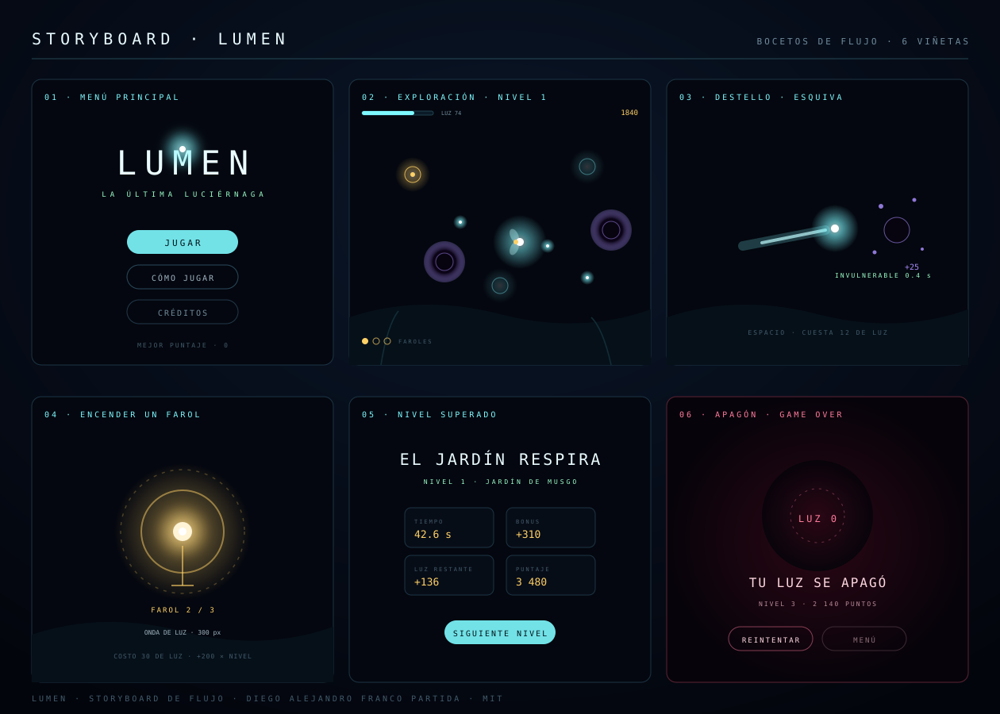

# Storyboard — LUMEN

> Seis viñetas que resumen el flujo completo de una partida: menú, exploración, combate, objetivo, recompensa y derrota.

<p align="center">
  
</p>

---

## 1. Menú principal

| Campo | Detalle |
| --- | --- |
| **Plano** | Pantalla completa, fondo nocturno con luciérnagas de fondo |
| **Acción** | Lumen parpadea sobre el título; el jugador elige **Jugar**, **Cómo jugar** o **Créditos** |
| **UI** | Título LUMEN, subtítulo, tres botones y récord local |
| **Duración** | Libre |
| **Nota de dirección** | La luz del título respira con la misma frecuencia que el aura del juego; la interfaz desaparece al empezar |

## 2. Exploración — Nivel 1

| Campo | Detalle |
| --- | --- |
| **Plano** | Vista cenital fija, 960 × 600 |
| **Acción** | Lumen se mueve entre chispas; dos sombras entran por los bordes; tres faroles esperan apagados |
| **UI** | Nivel, barra de luz, puntaje, tres puntos de farol |
| **Duración** | 40–90 s |
| **Nota de dirección** | La luz del jugador es la única fuente de iluminación real; el fondo se intuye, no se muestra |

## 3. Destello — esquiva y riesgo

| Campo | Detalle |
| --- | --- |
| **Plano** | Detalle del jugador en movimiento |
| **Acción** | Lumen pulsa **Espacio** y cruza a una sombra; la sombra estalla en partículas violetas |
| **UI** | Texto flotante «+25», estela de luz |
| **Duración** | 0.16 s de impulso, 1.05 s de enfriamiento |
| **Nota de dirección** | La estela debe leerse como una decisión, no como un efecto gratuito: cuesta 12 de luz |

## 4. Encender un farol

| Campo | Detalle |
| --- | --- |
| **Plano** | Farol en el centro, onda expansiva |
| **Acción** | Lumen llega con 30+ de luz; el farol se enciende y barre las sombras en 300 px |
| **UI** | «FAROL 2 / 3», «+400», puntos de farol actualizados |
| **Duración** | 0.75 s de onda |
| **Nota de dirección** | Es el momento más luminoso del nivel: flash ámbar, acorde mayor y sacudida suave |

## 5. Nivel superado

| Campo | Detalle |
| --- | --- |
| **Plano** | Panel centrado sobre el mundo congelado |
| **Acción** | Se muestran tiempo, bonus de tiempo, luz restante y puntaje total |
| **UI** | Botón **Siguiente nivel** |
| **Duración** | Libre (el jugador decide) |
| **Nota de dirección** | La música se detiene; el silencio hace que el acorde de subida de nivel destaque |

## 6. Apagón — Game Over

| Campo | Detalle |
| --- | --- |
| **Plano** | Pantalla teñida de rosa, el mundo se oscurece |
| **Acción** | La luz llega a 0; Lumen desaparece en partículas |
| **UI** | Puntaje, récord, nivel alcanzado, **Reintentar** y **Menú** |
| **Duración** | Libre |
| **Nota de dirección** | No hay castigo: el récord se conserva y el mensaje invita a volver |

---

## Flujo de pantallas

```text
 MENÚ ──▶ INTRO (3.2 s) ──▶ JUEGO ──┬──▶ NIVEL SUPERADO ──▶ INTRO (siguiente)
   ▲                                 │
   │                                 ├──▶ VICTORIA (nivel 5)
   │                                 │
   └────────────── PAUSA ◀───────────┴──▶ GAME OVER ──▶ REINTENTAR
```

## Transiciones

| De | A | Recurso |
| --- | --- | --- |
| Menú | Intro | Fundido del overlay (0.28 s) + música del nivel |
| Intro | Juego | Cuenta regresiva de 3.2 s o botón **Empezar ya** |
| Juego | Pausa | Overlay con blur; el mundo se congela |
| Juego | Nivel superado | Flash ámbar, onda del último farol |
| Juego | Game Over | Flash rosa, sacudida de 14 px, silencio musical |
| Nivel superado | Intro | Fundido y nueva nota raíz |

## Bocetos y principios de cámara

- **Encuadre:** siempre completo; nada importante queda fuera de pantalla.
- **Escala:** Lumen mide 22 px de diámetro; un farol, 36 px; una sombra, 30 px. La proporción hace que el jugador se sienta pequeño.
- **Lectura:** el 80 % de la pantalla es oscuridad; el 20 % restante es información.
- **Movimiento:** la cámara no se mueve; la sensación de velocidad viene de la estela del jugador y del paralaje de las motas.

## Relación con el GDD

Este storyboard corresponde a las secciones 3, 6, 10 y 11 del [GDD](GDD.md). Las posiciones de los faroles del nivel 1 están en el [mapa](../assets/mapa-nivel-1.svg).
